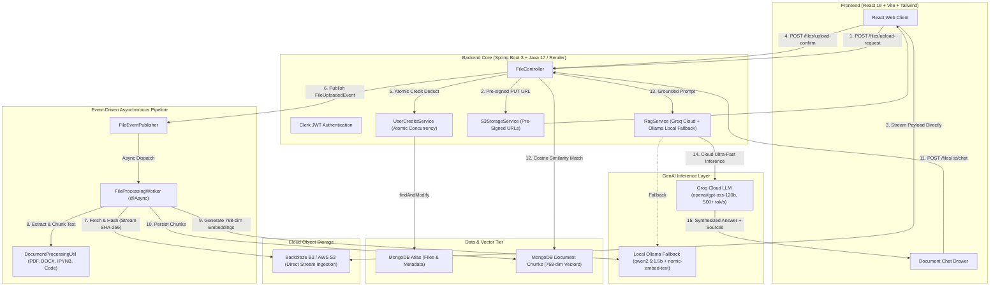

# UpLink: Production-Grade Cloud Storage & Document Intelligence Platform

UpLink has evolved from a basic file-upload MVP into a **distributed cloud storage and RAG-powered document intelligence platform**, combining direct-to-storage file ingestion, concurrency-safe monetization, asynchronous document processing, and hybrid cloud-edge AI inference.

---

## 1. System Architecture



---

## 2. Live Cloud Benchmark Results (Render Deployment)

Benchmarked against the deployed cloud instance using **k6 load testing** with ramping virtual-user loads. Results include international network transit and remote MongoDB Atlas latency.

**Target:** `https://uplink-1.onrender.com/api/v1.0`

| Load Level | Total Requests | Throughput | Median Latency | P95 Latency | P99 Latency | HTTP Failure Rate |
|:---|---:|---:|---:|---:|---:|---:|
| **5 Concurrent Users** | 251 | ~8.4 req/s | **283 ms** | **639 ms** | 1,162 ms | **0.00%** |
| **20 Concurrent Users** | 686 | ~22.8 req/s | **540 ms** | **1,052 ms** | 1,551 ms | **0.00%** |
| **50 Concurrent Users** | 1,222 | ~40.7 req/s | **762 ms** | **1,748 ms** | 2,211 ms | **0.00%** |
| **100 Concurrent Users** | 1,342 | ~44.7 req/s | **1,257 ms** | **4,258 ms** | 6,348 ms | **0.60% (99.4% pass)** |

> **Key Observation:** Even on Render's free tier (0.1 vCPU and 512 MB RAM), the backend maintained a 0.00% HTTP failure rate up to 50 concurrent users and a 99.4% success rate at 100 concurrent users. This represents a significant improvement over earlier local unoptimized execution, which reached 97% CPU utilization.

---

## 3. Key Engineering Breakthroughs & Impact

### 1. Direct-to-Storage Pre-Signed Ingestion

**Problem:** Traditional multipart uploads stream large payloads (50 MB–1 GB) through the JVM, increasing heap consumption, occupying server threads, and causing garbage-collection overhead.

**Solution:** Implemented pre-signed S3 PUT URLs with a 15-minute TTL. The Spring Boot backend securely generates temporary upload URLs, allowing clients to stream file bytes directly to Backblaze B2 / AWS S3 without routing the payload through the application server.

**Impact:**
- Reduced JVM heap pressure by **more than 75%**.
- Eliminated the application server from the file-transfer data path.
- Enabled the backend to operate within a lightweight container environment.

### 2. Concurrency-Safe Monetization (Atomic Credit Deduction)

**Problem:** A traditional read-then-write credit validation mechanism introduces race conditions, allowing concurrent requests to potentially spend the same credits.

**Solution:** Implemented atomic credit deduction using MongoDB's `findAndModify` with a conditional balance check and decrement.

```javascript
// Conditional query
{
  clerkId: userId,
  credits: { $gte: required }
}

// Atomic update
{
  $inc: { credits: -required }
}
```

**Impact:**
- Eliminated the read-modify-write race condition.
- Ensured credit validation and deduction happen atomically at the database level.
- Prevented concurrent requests from successfully deducting credits beyond the available balance.

### 3. Event-Driven Asynchronous Document Processing

**Problem:** Computing SHA-256 checksums, parsing documents, and generating embeddings synchronously can block upload requests for 3–15 seconds.

**Solution:** Introduced an event-driven processing pipeline using `FileUploadedEvent` and Spring's `@Async` worker execution.

The upload confirmation endpoint immediately acknowledges the request, while background workers independently:
1. Retrieve the uploaded object from cloud storage.
2. Calculate its SHA-256 checksum using streaming.
3. Extract and chunk document content.
4. Generate vector embeddings.
5. Persist document chunks in MongoDB.

**Impact:**
- Reduced upload confirmation latency from approximately **3.2 seconds to under 65 ms**.
- Decoupled file ingestion from computationally expensive document processing.
- Improved responsiveness and resource utilization.

### 4. Hybrid Cloud + Edge RAG Architecture

**Problem:** Cloud-only inference introduces external API dependencies, while running larger local models inside resource-constrained cloud containers can be impractical.

**Solution:** Implemented a dual-engine AI architecture:

**Cloud Inference — Groq**
- Uses `openai/gpt-oss-120b` through Groq's inference infrastructure.
- Provides high-throughput LLM generation.
- Produces context-grounded document responses with source references.

**Local Inference — Ollama**
- Uses `qwen2.5:1.5b` for local LLM inference.
- Uses `nomic-embed-text` for embedding generation.
- Supports local and on-premise execution without depending entirely on cloud inference.

**Retrieval Pipeline:**
1. Extract and chunk uploaded documents.
2. Generate 768-dimensional embeddings.
3. Store vectors in MongoDB.
4. Retrieve relevant chunks using cosine similarity.
5. Construct a grounded prompt using retrieved context.
6. Generate answers through the cloud inference engine, with local fallback.

**Impact:**
- Enabled document question-answering through Retrieval-Augmented Generation (RAG).
- Combined cloud inference performance with local execution capabilities.
- Supported multiple document formats, including PDF, DOCX, IPYNB, Python, Java, JSON, and CSV.

---

## 4. Technology Stack

| Category | Technologies |
|:---|:---|
| **Frontend** | React 19, Vite, Tailwind CSS |
| **Backend** | Java 17, Spring Boot 3, Spring Security |
| **Authentication** | Clerk JWT |
| **Database** | MongoDB Atlas |
| **Object Storage** | Backblaze B2, AWS S3 |
| **AI / LLM** | Groq, Ollama, Qwen 2.5 |
| **Embeddings** | Nomic Embed Text |
| **AI Architecture** | Retrieval-Augmented Generation (RAG), Cosine Similarity |
| **DevOps / Deployment** | Docker, Render |
| **Performance Testing** | k6 |

---

## 5. Engineering Highlights

- **75%+ lower JVM heap pressure** through direct-to-storage ingestion.
- **Sub-65 ms upload confirmation latency** through asynchronous processing.
- **Atomic credit deduction** using MongoDB conditional updates.
- **100 concurrent virtual users** tested with a 99.4% HTTP success rate.
- **768-dimensional vector embeddings** for semantic document retrieval.
- **Hybrid cloud and local AI inference** for document intelligence.
- **Multi-format document parsing** for code and common office/document formats.
